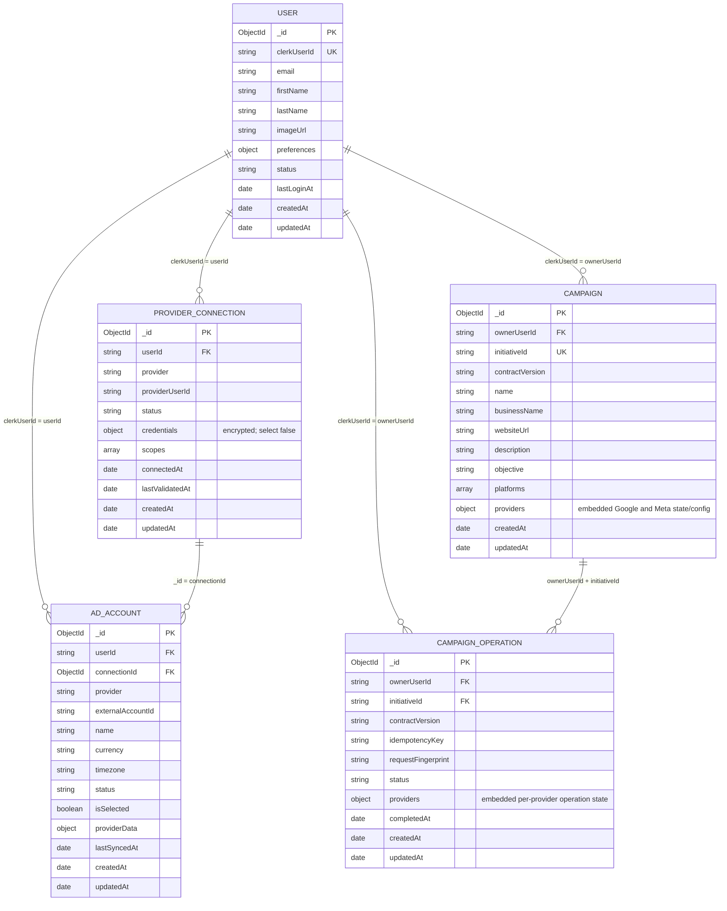
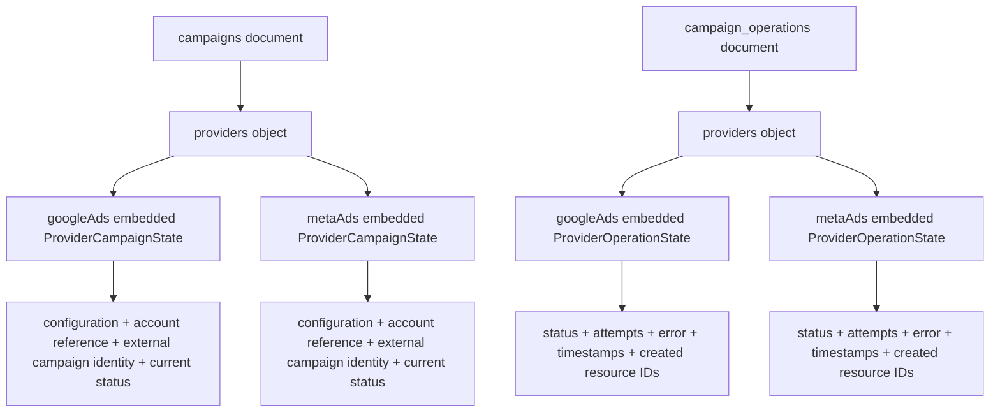

# Ads Management Platform — Database ERD and Collection Indexes

**Status:** Proposed target schema for the MongoDB/Mongoose application  
**Database:** One shared MongoDB database; tenant isolation is enforced in the application with `userId` / `ownerUserId` filters.  
**Providers currently in scope:** `googleAds`, `metaAds`

---

## 1. Important modeling decisions

1. **Only five MongoDB collections are in the core design:** `users`, `provider_connections`, `ad_accounts`, `campaigns`, and `campaign_operations`.
2. A logical campaign is **one document** in `campaigns`. Its Google Ads and Meta Ads execution data are embedded under `providers.googleAds` and `providers.metaAds`. They are **subdocuments, not collections and not separate ERD entities**.
3. `campaign_operations` remains separate because request idempotency, retries, and provider-by-provider execution outcomes have a lifecycle distinct from the campaign's saved configuration and current provider state.
4. Provider OAuth credentials remain in `provider_connections`, encrypted with the existing AES-256-GCM envelope. They must never be copied into campaign or account documents.
5. `ad_accounts` stores the locally synchronized account record. Campaign provider data should keep both the local `adAccountId` reference and the provider's external `accountId` string. The latter is needed for provider API calls and for preserving the current campaign contract.
6. Google/Meta campaign configuration is provider-specific. Keep it inside the corresponding provider subdocument; do not flatten it into a pretend universal provider configuration.
7. Ad sets, ad groups, ads, creatives, assets, and reports are **not included as collections yet**. Fetch those from provider APIs for now. Add local collections only when the application needs durable local ownership, editing, history, or reporting snapshots for those objects.

> **Migration note:** The campaign repository/factory shared earlier currently creates one `CampaignRecord` per provider. This document describes the proposed unified target shape. Do not switch the campaign indexes or write path until the factory, repository, and any existing campaign records have been migrated together.

---

## 2. Corrected ER diagram — collections and relationships

The diagram below contains only real MongoDB collections. `providers` in `CAMPAIGN` and `CAMPAIGN_OPERATION` are embedded documents shown as JSON fields; they are deliberately not drawn as entities.

### Relationship meaning

| Relationship | Stored reference / join key | Meaning |
|---|---|---|
| `users` → `provider_connections` | `users.clerkUserId = provider_connections.userId` | A Clerk user may connect multiple provider identities. |
| `users` → `ad_accounts` | `users.clerkUserId = ad_accounts.userId` | Account records are tenant-owned; keep this field for safe user-scoped queries. |
| `provider_connections` → `ad_accounts` | `provider_connections._id = ad_accounts.connectionId` | Each synced account belongs to the provider connection that discovered it. |
| `users` → `campaigns` | `users.clerkUserId = campaigns.ownerUserId` | Each logical campaign belongs to one application user. |
| `users` → `campaign_operations` | `users.clerkUserId = campaign_operations.ownerUserId` | Each create/retry operation is tenant-owned. |
| `campaigns` → `campaign_operations` | `(ownerUserId, initiativeId)` | A logical campaign can have multiple operation records over time. An operation can temporarily exist before its campaign document during recovery/reconciliation. |

MongoDB does not enforce relational foreign keys. These are application-level references. Every read and update must include the owning `userId` / `ownerUserId`; do not trust an ObjectId supplied by the client without checking ownership.

---

## 3. Collection definitions and fields

The field lists below describe the target schema. `createdAt` and `updatedAt` are supplied by Mongoose timestamps where enabled. Optional values are marked `?`; nullable values are marked `| null`.

### 3.1 `users`

**Purpose:** Application user profile linked to Clerk. This collection is not the OAuth credential store.

| Field | Type | Required | Notes |
|---|---|---:|---|
| `_id` | `ObjectId` | Yes | MongoDB primary key. |
| `clerkUserId` | `string` | Yes | Stable external identity from Clerk; unique alternate key. |
| `email` | `string` | No | Profile/contact data; do not assume it is immutable. |
| `firstName` | `string` | No | Profile data. |
| `lastName` | `string` | No | Profile data. |
| `imageUrl` | `string` | No | Profile image URL. |
| `preferences` | `object` / `Mixed` | No | User-level UI/application preferences only. |
| `status` | `string` | Yes | Application user state, for example active/disabled; use the enum already adopted by the model. |
| `lastLoginAt` | `Date \| null` | No | Most recent successful login observed by the app. |
| `createdAt` | `Date` | Yes | Mongoose timestamp. |
| `updatedAt` | `Date` | Yes | Mongoose timestamp. |

**Indexes**

| Index | Definition | Options / purpose |
|---|---|---|
| Primary | `{ _id: 1 }` | Built-in MongoDB primary-key index. |
| Unique Clerk identity | `{ clerkUserId: 1 }` | `unique: true`; lookup and prevent duplicate application users for one Clerk identity. |

No unique email index is proposed. Email can change and may not be the canonical application identity; `clerkUserId` is the identity key.

### 3.2 `provider_connections`

**Purpose:** One OAuth connection for a user/provider identity. Keep credentials encrypted here, separate from account and campaign data.

| Field | Type | Required | Notes |
|---|---|---:|---|
| `_id` | `ObjectId` | Yes | Primary key; referenced by `ad_accounts.connectionId`. |
| `userId` | `string` | Yes | Clerk user ID; tenant owner. |
| `provider` | `string` | Yes | Enum: `googleAds` or `metaAds`. |
| `providerUserId` | `string` | No | Provider-side identity/account that authorized the connection, when available. |
| `status` | `string` | Yes | Enum such as connected, expired, revoked, error (use the model's actual enum). |
| `credentials.accessToken` | `EncryptedSecret` | Yes when connected | AES-256-GCM encrypted envelope; schema path should be `select: false`. |
| `credentials.refreshToken` | `EncryptedSecret \| null` | No | Encrypted refresh token; nullable for providers/flows that do not issue one. |
| `credentials.expiresAt` | `Date \| null` | No | Access-token expiry. |
| `credentials.tokenType` | `string \| null` | No | Optional OAuth token type. |
| `scopes` | `string[]` | No | Granted OAuth scopes. |
| `connectedAt` | `Date \| null` | No | Initial/most recent successful connection time. |
| `lastValidatedAt` | `Date \| null` | No | Last successful validation against provider. |
| `createdAt` | `Date` | Yes | Mongoose timestamp. |
| `updatedAt` | `Date` | Yes | Mongoose timestamp. |

`EncryptedSecret` is the existing envelope shape: `{ version, iv, authTag, ciphertext }`. Do not store plaintext access or refresh tokens. Token-refresh code must explicitly select credentials when needed and must never serialize them into API responses or logs.

**Indexes**

| Index | Definition | Options / purpose |
|---|---|---|
| Primary | `{ _id: 1 }` | Built-in. |
| Provider identity unique | `{ userId: 1, provider: 1, providerUserId: 1 }` | `unique: true`, partial filter `{ providerUserId: { $type: "string" } }`; prevents duplicate connection records for the same known provider identity. |
| User/provider status lookup | `{ userId: 1, provider: 1, status: 1 }` | Lists the user's connections by provider and connection state. |

The partial unique index intentionally allows multiple records when `providerUserId` is absent. It does **not** enforce one connection per provider per user; a user may have multiple provider identities.

### 3.3 `ad_accounts`

**Purpose:** Locally synchronized list of advertising accounts available through a provider connection. This is the app's account-selection and ownership record, not a replacement for the provider's live API.

| Field | Type | Required | Notes |
|---|---|---:|---|
| `_id` | `ObjectId` | Yes | Primary key. |
| `userId` | `string` | Yes | Clerk user ID; tenant owner. |
| `connectionId` | `ObjectId` | Yes | Reference to `provider_connections._id`. Validate that the connection belongs to the same `userId` and `provider`. |
| `provider` | `string` | Yes | Enum: `googleAds` or `metaAds`. Must agree with the referenced connection's provider. |
| `externalAccountId` | `string` | Yes | Provider's account identifier, e.g. Google customer ID/resource identifier or Meta `act_...` ID. |
| `name` | `string` | Yes | Display name from provider. |
| `currency` | `string \| null` | No | Provider account currency when available. |
| `timezone` | `string \| null` | No | Provider account timezone when available. |
| `status` | `string` | Yes | Local/provider account status; use a stable normalized enum plus provider details in `providerData` if needed. |
| `isSelected` | `boolean` | Yes | Whether this account is selected for the corresponding user/connection/provider. |
| `providerData` | `Mixed` / `object` | No | Limited provider-specific metadata not represented by common fields. Avoid copying large API responses. |
| `lastSyncedAt` | `Date \| null` | No | Last successful account synchronization. |
| `createdAt` | `Date` | Yes | Mongoose timestamp. |
| `updatedAt` | `Date` | Yes | Mongoose timestamp. |

**Indexes**

| Index | Definition | Options / purpose |
|---|---|---|
| Primary | `{ _id: 1 }` | Built-in. |
| Provider account unique | `{ userId: 1, connectionId: 1, provider: 1, externalAccountId: 1 }` | `unique: true`; prevents importing the same account twice for one connection. |
| One selected account per connection/provider | `{ userId: 1, connectionId: 1, provider: 1 }` | `unique: true`, partial filter `{ isSelected: true }`; enforces at most one selected account for each user + connection + provider. |
| User/provider/status lookup | `{ userId: 1, provider: 1, status: 1 }` | Lists selectable/active accounts for a user and provider. |

**Selection semantics:** The partial unique index above enforces one selected account per connection and provider. If the product requirement is instead exactly one selected account across *all* connections for a user/provider, change the partial unique index to `{ userId: 1, provider: 1 }` and migrate existing selections before creating it. Do not silently mix these two rules.

### 3.4 `campaigns` — unified logical campaign

**Purpose:** One document per logical campaign/initiative, regardless of whether it targets Google Ads, Meta Ads, or both. Shared campaign brief fields live once at the top level; provider-specific configuration and execution state are embedded per provider.

| Field | Type | Required | Notes |
|---|---|---:|---|
| `_id` | `ObjectId` | Yes | Primary key. |
| `ownerUserId` | `string` | Yes | Clerk user ID; tenant owner. |
| `initiativeId` | `string` | Yes | Stable logical campaign identifier generated by the campaign factory; unique within a user. |
| `contractVersion` | `string` | Yes | Version of the normalized campaign-builder input contract. |
| `name` | `string` | Yes | Shared campaign name. |
| `businessName` | `string` | Yes | Shared business name. |
| `websiteUrl` | `string \| null` | No | Shared website. |
| `description` | `string \| null` | No | Shared campaign description. |
| `objective` | `string` | Yes | Shared high-level objective from the campaign contract. |
| `platforms` | `string[]` | Yes | Unique non-empty subset of `googleAds`, `metaAds`; should match the provider subdocuments present. |
| `providers.googleAds` | `ProviderCampaignState \| undefined` | No | Embedded Google Ads configuration and execution state. |
| `providers.metaAds` | `ProviderCampaignState \| undefined` | No | Embedded Meta Ads configuration and execution state. |
| `createdAt` | `Date` | Yes | Mongoose timestamp. |
| `updatedAt` | `Date` | Yes | Mongoose timestamp. |

Each `ProviderCampaignState` subdocument should contain:

| Embedded field | Type | Required | Notes |
|---|---|---:|---|
| `adAccountId` | `ObjectId \| null` | No | Local reference to `ad_accounts._id`; validate same user and provider. |
| `accountId` | `string` | Yes | Provider's external account ID. Preserve this for API calls and compatibility with the current input contract. |
| `providerObjective` | `string \| null` | No | Provider-specific objective, when it differs from the shared objective. |
| `providerCampaignType` | `string \| null` | No | Provider-specific campaign type. |
| `requestedProviderApiTarget` | `string \| null` | No | API target/version requested for this provider, if used by the execution layer. |
| `configuration` | `object` / `Mixed` | Yes | Provider-specific normalized configuration snapshot required for reliable retry/reconciliation. Do not replace this with a flattened universal config. |
| `providerCampaignId` | `string \| null` | No | External campaign ID returned by the provider. |
| `providerCampaignResourceName` | `string \| null` | No | Provider resource name, where applicable (for example Google Ads). |
| `providerStatus` | `string \| null` | No | Raw/normalized provider status. |
| `creationStatus` | `string` | Yes | Suggested values: pending, active, failed; preserve the status vocabulary already used by the application. |
| `deliveryStatus` | `string` | Yes | Provider-specific delivery state; do not assume Google and Meta use identical raw values. |
| `resources` | `object[]` | No | Small references/IDs of resources created as part of campaign setup, not full ads/ad sets/creative documents. |
| `lastError` | `string \| null` | No | Most recent provider-specific creation/sync error. |
| `lastSyncedAt` | `Date \| null` | No | Last successful sync of this provider's campaign state. |

Keep transient request execution details (for example a short-lived execution plan) in `campaign_operations` when they describe an attempt rather than the durable campaign configuration. Avoid storing the same provider configuration in two different fields.

**Indexes**

| Index | Definition | Options / purpose |
|---|---|---|
| Primary | `{ _id: 1 }` | Built-in. |
| Logical campaign unique | `{ ownerUserId: 1, initiativeId: 1 }` | `unique: true`; one logical campaign per initiative per user. |
| User campaign list | `{ ownerUserId: 1, updatedAt: -1 }` | Efficient user-scoped campaign listing by most recently updated. |
| Google external campaign unique | `{ ownerUserId: 1, "providers.googleAds.accountId": 1, "providers.googleAds.providerCampaignId": 1 }` | `unique: true`, partial filter `{ "providers.googleAds.providerCampaignId": { $type: "string" } }`; prevents duplicate imported/created Google campaign identities. |
| Meta external campaign unique | `{ ownerUserId: 1, "providers.metaAds.accountId": 1, "providers.metaAds.providerCampaignId": 1 }` | `unique: true`, partial filter `{ "providers.metaAds.providerCampaignId": { $type: "string" } }`; prevents duplicate Meta campaign identities. |
| Google account campaign lookup | `{ ownerUserId: 1, "providers.googleAds.accountId": 1, updatedAt: -1 }` | Optional; add if account-filtered Google campaign listing is a frequent query. |
| Meta account campaign lookup | `{ ownerUserId: 1, "providers.metaAds.accountId": 1, updatedAt: -1 }` | Optional; add if account-filtered Meta campaign listing is a frequent query. |

The two provider external-ID unique indexes are separate because a Google campaign ID and a Meta campaign ID belong to different provider namespaces. The partial filters prevent documents without that provider/campaign ID from participating in the unique constraint.

### 3.5 `campaign_operations`

**Purpose:** Durable record of a campaign create/update execution request. It owns idempotency and tracks Google and Meta independently, so a partial provider failure does not erase a successful provider result.

| Field | Type | Required | Notes |
|---|---|---:|---|
| `_id` | `ObjectId` | Yes | Primary key. |
| `ownerUserId` | `string` | Yes | Clerk user ID; tenant owner. |
| `initiativeId` | `string` | Yes | Links logically to `campaigns` using `(ownerUserId, initiativeId)`. |
| `contractVersion` | `string` | Yes | Contract version used to validate/build the request. |
| `idempotencyKey` | `string` | Yes | Client/request key; unique per user. |
| `requestFingerprint` | `string` | Yes | Hash of normalized intent; exclude volatile execution-only fields as the factory currently does. |
| `status` | `string` | Yes | Overall status, e.g. queued, running, completed, partially_failed, failed, needs_reconciliation. Keep the actual service enum authoritative. |
| `providers.googleAds` | `ProviderOperationState \| undefined` | No | Embedded Google execution status. |
| `providers.metaAds` | `ProviderOperationState \| undefined` | No | Embedded Meta execution status. |
| `completedAt` | `Date \| null` | No | Overall completion time. |
| `createdAt` | `Date` | Yes | Mongoose timestamp. |
| `updatedAt` | `Date` | Yes | Mongoose timestamp; also used by worker/reconciliation polling. |

Each `ProviderOperationState` subdocument should contain:

| Embedded field | Type | Required | Notes |
|---|---|---:|---|
| `status` | `string` | Yes | Provider-level pending/running/succeeded/failed/reconciliation state. |
| `campaignId` | `ObjectId \| null` | No | Optional local reference to the unified `campaigns._id`, useful after campaign persistence. |
| `providerCampaignId` | `string \| null` | No | External campaign ID if the provider call succeeded. |
| `resources` | `object[]` | No | IDs/resource names produced by this attempt. |
| `attemptCount` | `number` | Yes | Number of attempts for this provider. |
| `error` | `object \| null` | No | Structured error code/message/details; redact secrets and tokens. |
| `startedAt` | `Date \| null` | No | Provider execution start. |
| `finishedAt` | `Date \| null` | No | Provider execution finish. |

**Indexes**

| Index | Definition | Options / purpose |
|---|---|---|
| Primary | `{ _id: 1 }` | Built-in. |
| Idempotency unique | `{ ownerUserId: 1, idempotencyKey: 1 }` | `unique: true`; same user cannot create the same operation twice. |
| Initiative history | `{ ownerUserId: 1, initiativeId: 1, createdAt: -1 }` | Fetch operation history/retries for one logical campaign. |
| Worker/reconciliation queue | `{ status: 1, updatedAt: 1 }` | Find stale queued/running/needs-reconciliation operations. Add a partial filter for active statuses if queue volume later justifies it. |

**Idempotency rule:** If the same `(ownerUserId, idempotencyKey)` arrives again with the same fingerprint, return/reconcile the existing operation. If the key is reused with a different fingerprint, reject it as a conflict. A unique index prevents duplicate operation records, but the service must enforce the fingerprint comparison.

---

## 4. Embedded provider shapes are not collections

This is the hierarchy inside the two documents that contain provider-specific subdocuments:

This keeps provider execution independent while avoiding two campaign documents for one user-facing campaign. A Google failure can update only `providers.googleAds` and its operation state; the Meta state remains intact.

---

## 5. Index implementation checklist

Before creating indexes in production:

1. Check for duplicates that would violate each proposed unique index. Resolve duplicates before calling `createIndex()`.
2. Confirm the intended account-selection rule: one selected account per **connection/provider** (current model) or one per **user/provider** (different index).
3. Migrate the campaign write path from one document per provider to one unified document per initiative, then backfill existing campaign records grouped by `(ownerUserId, initiativeId)`.
4. Replace legacy campaign indexes that assume top-level `provider`, `accountId`, `providerCampaignId`, or `creationStatus`. Those paths move under `providers.googleAds` / `providers.metaAds` in this target model.
5. Keep the operation unique index `{ ownerUserId: 1, idempotencyKey: 1 }`; it remains valid in the unified design.
6. Use tenant ownership predicates on every query and update. For example, campaign reads should filter by `{ ownerUserId: clerkUserId, initiativeId }`, not by `initiativeId` alone.
7. Do not use a MongoDB transaction around Google/Meta API calls. Persist the operation, call providers independently, and persist each result/error. A database transaction cannot roll back an external provider API side effect.

### Index inventory at a glance

| Collection | Required indexes |
|---|---|
| `users` | `{ clerkUserId: 1 }` unique |
| `provider_connections` | `{ userId: 1, provider: 1, providerUserId: 1 }` unique partial; `{ userId: 1, provider: 1, status: 1 }` |
| `ad_accounts` | `{ userId: 1, connectionId: 1, provider: 1, externalAccountId: 1 }` unique; `{ userId: 1, connectionId: 1, provider: 1 }` unique partial on `isSelected: true`; `{ userId: 1, provider: 1, status: 1 }` |
| `campaigns` | `{ ownerUserId: 1, initiativeId: 1 }` unique; `{ ownerUserId: 1, updatedAt: -1 }`; provider-specific partial unique indexes for Google and Meta external campaign IDs |
| `campaign_operations` | `{ ownerUserId: 1, idempotencyKey: 1 }` unique; `{ ownerUserId: 1, initiativeId: 1, createdAt: -1 }`; `{ status: 1, updatedAt: 1 }` |

Avoid adding indexes speculatively. Each index adds write/storage cost; add the optional provider-account listing indexes only when the corresponding query is used frequently and query plans show a benefit.

---

## 6. Collections intentionally deferred

These are provider-native resources or reporting data, not part of the initial core collection set:

| Data | Initial approach | Create a local collection later when… |
|---|---|---|
| Google ad groups / Meta ad sets | Fetch from provider APIs | The app needs durable local editing, cross-provider workflows, or local filtering at scale. |
| Ads | Fetch from provider APIs | The app needs local lifecycle state, audit history, or a unified ad editor. |
| Creatives and assets | Store only references/IDs in campaign resources initially | The app owns uploaded asset metadata, re-use, moderation, or lifecycle tracking. |
| Performance reports / metrics | Query provider reporting APIs initially | The app needs historical snapshots, custom aggregation, or dashboards independent of provider retention/API availability. |
| OAuth sessions | Keep in the existing OAuth flow unless a durable session record is required | The app needs multi-step OAuth state persistence beyond signed state/callback handling. |

Do not create empty collections for these concepts just because routes may exist. A route is not, by itself, a reason to persist a separate collection.

---

## 7. Current implementation versus this target ERD

| Area | Current state known from the shared code | Target described here |
|---|---|---|
| User identity | `users` model keyed by `clerkUserId` | Same |
| OAuth connections | `provider_connections`, encrypted credentials | Same |
| Ad accounts | `ad_accounts`, each linked to `connectionId` | Same; document local account reference in campaign provider state |
| Campaigns | Repository/factory create one record per selected provider, linked by `initiativeId` | One `campaigns` document per initiative, with embedded Google/Meta subdocuments |
| Operations | Separate `campaign_operations`, keyed by user + idempotency key, provider statuses nested | Same collection and core idempotency pattern; align provider state with unified campaign |

The user/account migration was reported as successful earlier. That does not mean the campaign repository/factory has already been migrated to the unified target. Treat campaign changes as a separate migration and deploy them only after dry-run, backup, duplicate checks, and API tests.

